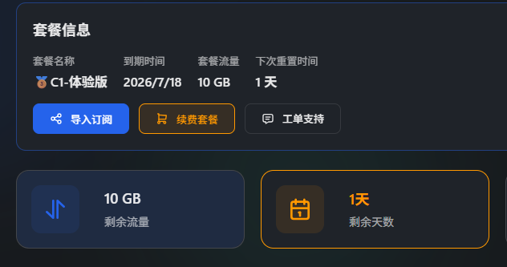
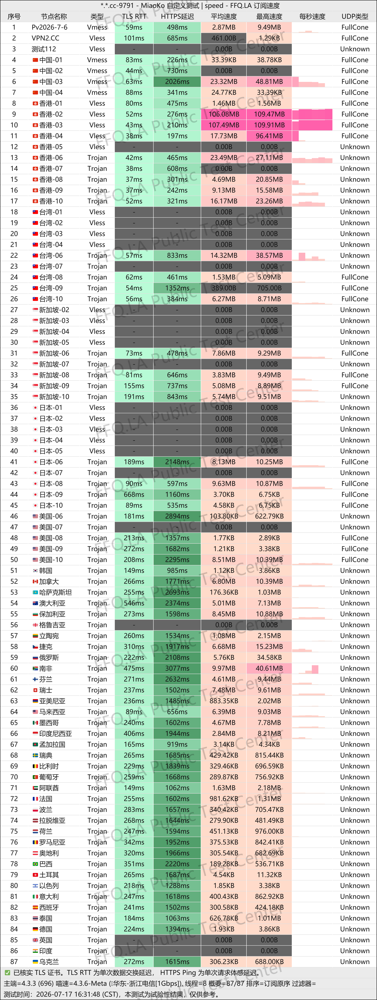
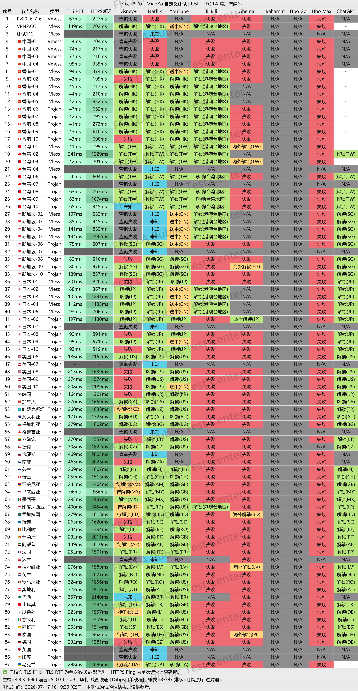
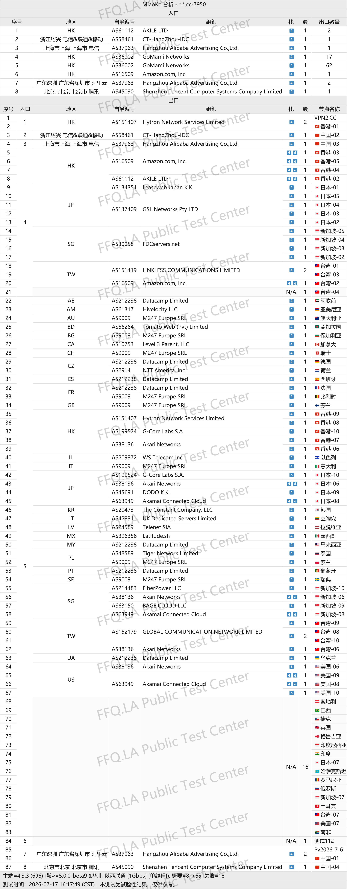

🇨🇳 [中文](README.md) | 🇺🇸 English | 🇷🇺 [Русский](README_RU.md) | 🇮🇷 [فارسی](README_FA.md)

# XiaoFeiJi VPN Official Website (Updated November 11, 2026)

XiaoFeiJi VPN Official Website<br>

~~Latest Address: [dash3.ww01.cc](https://to.iix.im/xfj01)~~<br>
~~Official Website: [vpn2.cc](https://to.iix.im/xfj02)~~<br>

⚠️ **The service has become unreachable for the second time.**

2026 Best VPN Recommendations and Proxy Node Sharing: [https://github.com/jdnei/JiChangTuiJian](https://github.com/jdnei/JiChangTuiJian)<br>

## Telegram VPN Community #AD

[VPN Giveaway Group](https://331024.de/archives/choujiang) | [VPN Chat Group](https://331024.de/archives/choujiang) | [VPN Trial Group](https://331024.de/archives/choujiang)<br>

[https://331024.de/archives/choujiang](https://331024.de/archives/choujiang)

## Invitation Code

`Register with this invitation code to receive a free 1-day trial plan with 10 GB of traffic.`

```bash
L99sYi8J
```



## Introduction

XiaoFeiJi VPN provides high-speed network access through multiple proxy nodes across various countries and regions.

The service supports multiple platforms and is designed for everyday internet browsing, studying, remote work, and streaming entertainment.

## Advantages

XiaoFeiJi VPN offers:

- Extensive node coverage across multiple countries and regions, including `nodes located in China`.
- Stable connection speeds and relatively low latency.
- Support for multiple simultaneous device connections.
- Compatibility with popular proxy clients.
- Straightforward configuration and setup.
- Affordable subscription plans.
- Relatively responsive customer support.

## Subscription Plans

| Plan | Price | Billing | Traffic | Devices | Bandwidth | Network Routes | Node Coverage | Additional Features |
|---|---|---|---|---|---|---|---|---|
| Free – Community Plan | ¥0.00 | One-time | 100 GB (no reset) | 2 | 10 Mbps | High-speed direct connections | 5 countries/regions | Unblocks Netflix, Disney+, HBO, YouTube Premium, ChatGPT, Google Bard, and Midjourney |
| 🥉 C1 – Trial | ¥1.00 | Monthly | 10 GB/month (resets monthly) | 2 | 100 Mbps | High-speed direct connections | 32 countries/regions | Unblocks Netflix, Disney+, HBO, YouTube Premium, ChatGPT, Google Bard, and Midjourney |
| 🏆 C2 – Lite | ¥5.00 | Monthly | 100 GB/month (resets monthly) | 3 | Unlimited | Overseas BGP transit nodes | 32 countries/regions | Unblocks Netflix, Disney+, HBO, YouTube Premium, ChatGPT, Google Bard, and Midjourney |
| 🥉 C3 – Standard | ¥15.00 | Monthly | 300 GB/month (resets monthly) | 5 | Unlimited | Overseas BGP transit nodes | 32 countries/regions | Unblocks Netflix, Disney+, HBO, YouTube Premium, ChatGPT, Google Bard, and Midjourney |
| 🥉 C4 – Premium | ¥38.00 | Monthly | 1000 GB/month (resets monthly) | Unlimited | Unlimited | Overseas BGP transit nodes | 32 countries/regions | Unblocks Netflix, Disney+, HBO, YouTube Premium, ChatGPT, Google Bard, and Midjourney |
| F1 – 50 GB No Expiration | ¥5.00 | One-time | 50 GB (no reset) | 3 | Unlimited | Overseas BGP transit nodes | 32 countries/regions | Unblocks Netflix, Disney+, HBO, YouTube Premium, ChatGPT, Google Bard, and Midjourney |
| F2 – 100 GB No Expiration | ¥8.00 | One-time | 80 GB (no reset) | 3 | Unlimited | Overseas BGP transit nodes | 32 countries/regions | Unblocks Netflix, Disney+, HBO, YouTube Premium, ChatGPT, Google Bard, and Midjourney |
| F3 – 200 GB No Expiration | ¥15.00 | One-time | 200 GB (no reset) | 3 | Unlimited | Overseas BGP transit nodes | 32 countries/regions | Unblocks Netflix, Disney+, HBO, YouTube Premium, ChatGPT, Google Bard, and Midjourney |

## 📊 Performance Tests and Analysis

#### 1. Evening Peak-Hour Speed Test



#### 2. Streaming Platform Unblocking Report



#### 3. Entry and Exit Node Analysis


