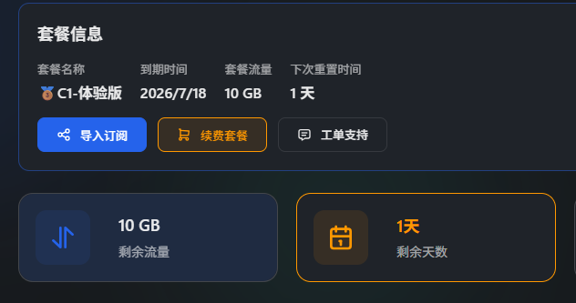
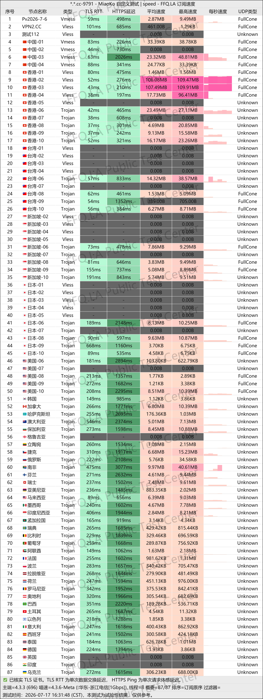
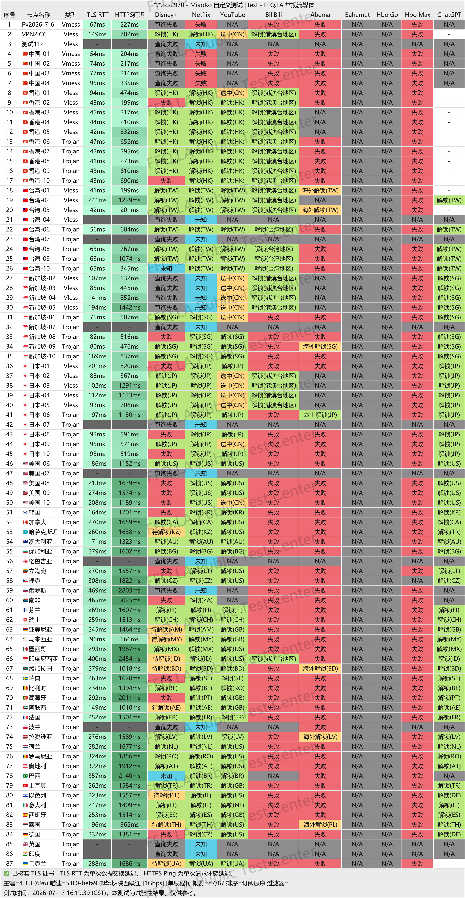
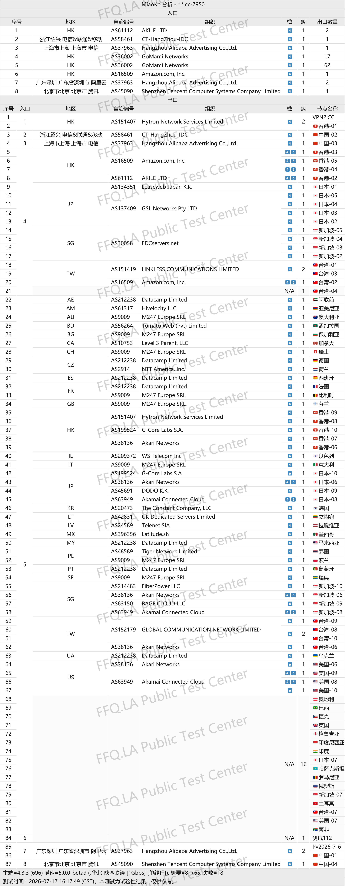

 🇨🇳 [中文](README.md) | 🇺🇸 [English](README_EN.md) | 🇷🇺 [Русский](README_RU.md) | 🇮🇷 فارسی

# وب‌سایت رسمی فیلترشکن XiaoFeiJi VPN(به‌روزرسانی 12 نوامبر 2026)
وب‌سایت رسمی فیلترشکن XiaoFeiJi VPN<br>

~~جدیدترین آدرس: [dash3.ww01.cc](https://to.iix.im/xfj01)~~<br>
~~وب‌سایت رسمی: [vpn2.cc](https://to.iix.im/xfj02)~~<br>

⚠️ **این سرویس برای دومین بار از دسترس خارج شده است.**

معرفی بهترین سرویس‌های VPN و اشتراک‌گذاری سرورهای پروکسی در سال ۲۰۲۶: [https://github.com/jdnei/JiChangTuiJian](https://github.com/jdnei/JiChangTuiJian)<br>

## انجمن تلگرامی VPN #AD

[گروه قرعه‌کشی VPN](https://331024.de/archives/choujiang) | [گروه گفت‌وگوی VPN](https://331024.de/archives/choujiang) | [گروه تست VPN](https://331024.de/archives/choujiang)<br>

[https://331024.de/archives/choujiang](https://331024.de/archives/choujiang)

## کد دعوت

`با ثبت‌نام از طریق این کد دعوت، یک اشتراک آزمایشی رایگان یک‌روزه با ۱۰ گیگابایت ترافیک دریافت می‌کنید.`

```bash
L99sYi8J
```



## معرفی

XiaoFeiJi VPN یک سرویس دسترسی به اینترنت پرسرعت است که از طریق سرورهای پروکسی متعدد در کشورهای مختلف خدمات ارائه می‌دهد.

این سرویس با پلتفرم‌های گوناگون سازگار است و برای وب‌گردی روزمره، مطالعه، دورکاری و تماشای محتوای آنلاین طراحی شده است.

## مزایا

مزایای اصلی XiaoFeiJi VPN عبارت‌اند از:

- پوشش گسترده سرورها در کشورهای مختلف، از جمله `سرورهایی در داخل چین`.
- سرعت اتصال پایدار و تأخیر نسبتاً پایین.
- پشتیبانی از اتصال هم‌زمان چندین دستگاه.
- سازگاری با کلاینت‌های رایج پروکسی.
- راه‌اندازی و پیکربندی ساده.
- طرح‌های اشتراک مقرون‌به‌صرفه.
- پاسخ‌گویی نسبتاً سریع پشتیبانی مشتریان.

## طرح‌های اشتراک

| طرح | قیمت | دوره پرداخت | حجم ترافیک | تعداد دستگاه | پهنای باند | نوع اتصال | پوشش سرورها | امکانات اضافی |
|---|---|---|---|---|---|---|---|---|
| Free – طرح رایگان عمومی | ¥0.00 | یک‌بار پرداخت | 100 گیگابایت (بدون بازنشانی) | ۲ دستگاه | 10 مگابیت بر ثانیه | اتصال مستقیم پرسرعت | ۵ کشور/منطقه | رفع محدودیت Netflix، Disney+، HBO، YouTube Premium، ChatGPT، Google Bard و Midjourney |
| 🥉 C1 – آزمایشی | ¥1.00 | ماهانه | 10 گیگابایت در ماه (بازنشانی ماهانه) | ۲ دستگاه | 100 مگابیت بر ثانیه | اتصال مستقیم پرسرعت | ۳۲ کشور/منطقه | رفع محدودیت Netflix، Disney+، HBO، YouTube Premium، ChatGPT، Google Bard و Midjourney |
| 🏆 C2 – سبک | ¥5.00 | ماهانه | 100 گیگابایت در ماه (بازنشانی ماهانه) | ۳ دستگاه | بدون محدودیت | سرورهای انتقال BGP در خارج از کشور | ۳۲ کشور/منطقه | رفع محدودیت Netflix، Disney+، HBO، YouTube Premium، ChatGPT، Google Bard و Midjourney |
| 🥉 C3 – استاندارد | ¥15.00 | ماهانه | 300 گیگابایت در ماه (بازنشانی ماهانه) | ۵ دستگاه | بدون محدودیت | سرورهای انتقال BGP در خارج از کشور | ۳۲ کشور/منطقه | رفع محدودیت Netflix، Disney+، HBO، YouTube Premium، ChatGPT، Google Bard و Midjourney |
| 🥉 C4 – پیشرفته | ¥38.00 | ماهانه | 1000 گیگابایت در ماه (بازنشانی ماهانه) | نامحدود | بدون محدودیت | سرورهای انتقال BGP در خارج از کشور | ۳۲ کشور/منطقه | رفع محدودیت Netflix، Disney+، HBO، YouTube Premium، ChatGPT، Google Bard و Midjourney |
| F1 – بسته 50 گیگابایتی بدون محدودیت زمانی | ¥5.00 | یک‌بار پرداخت | 50 گیگابایت (بدون بازنشانی) | ۳ دستگاه | بدون محدودیت | سرورهای انتقال BGP در خارج از کشور | ۳۲ کشور/منطقه | رفع محدودیت Netflix، Disney+، HBO، YouTube Premium، ChatGPT، Google Bard و Midjourney |
| F2 – بسته 100 گیگابایتی بدون محدودیت زمانی | ¥8.00 | یک‌بار پرداخت | 80 گیگابایت (بدون بازنشانی) | ۳ دستگاه | بدون محدودیت | سرورهای انتقال BGP در خارج از کشور | ۳۲ کشور/منطقه | رفع محدودیت Netflix، Disney+، HBO، YouTube Premium، ChatGPT، Google Bard و Midjourney |
| F3 – بسته 200 گیگابایتی بدون محدودیت زمانی | ¥15.00 | یک‌بار پرداخت | 200 گیگابایت (بدون بازنشانی) | ۳ دستگاه | بدون محدودیت | سرورهای انتقال BGP در خارج از کشور | ۳۲ کشور/منطقه | رفع محدودیت Netflix، Disney+، HBO، YouTube Premium، ChatGPT، Google Bard و Midjourney |

## 📊 آزمایش عملکرد و تحلیل

#### ۱. آزمایش سرعت در ساعات اوج مصرف شبانه



#### ۲. گزارش رفع محدودیت سرویس‌های پخش آنلاین



#### ۳. تحلیل سرورهای ورودی و خروجی


