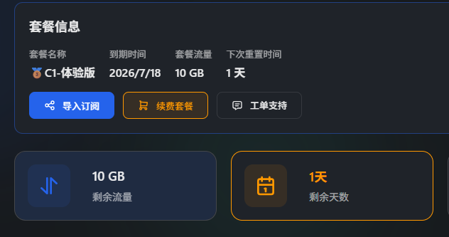
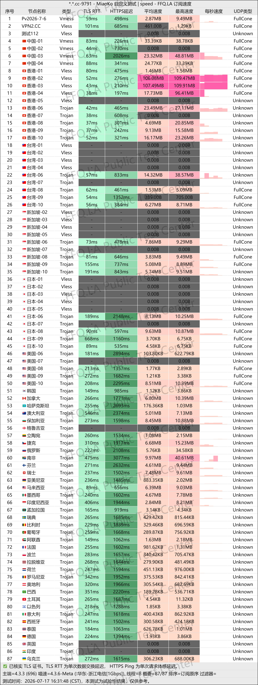
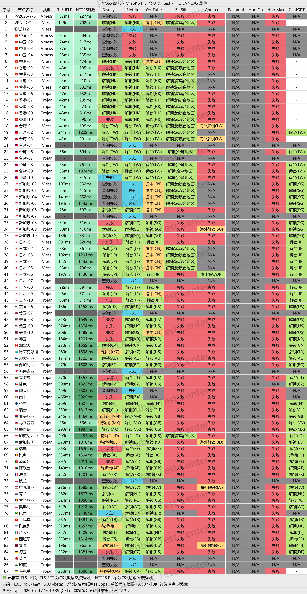
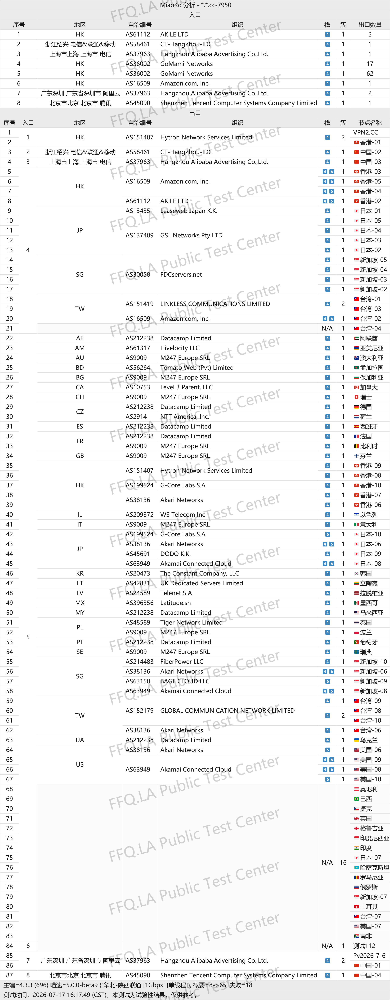

🇨🇳 [中文](README.md) | 🇺🇸 [English](README_EN.md) | 🇷🇺 Русский | 🇮🇷 [فارسی](README_FA.md)

# Официальный сайт XiaoFeiJi VPN (обновлено 12 ноября 2026)

Официальный сайт XiaoFeiJi VPN<br>

~~Новый адрес: [dash3.ww01.cc](https://to.iix.im/xfj01)~~<br>
~~Официальный сайт: [vpn2.cc](https://to.iix.im/xfj02)~~<br>

⚠️ **Сервис стал недоступен уже во второй раз.**

Лучшие VPN-сервисы и прокси-серверы 2026 года: [https://github.com/jdnei/JiChangTuiJian](https://github.com/jdnei/JiChangTuiJian)<br>

## Telegram-сообщество VPN #AD

[Группа розыгрышей VPN](https://331024.de/archives/choujiang) | [Чат VPN](https://331024.de/archives/choujiang) | [Группа тестирования VPN](https://331024.de/archives/choujiang)<br>

[https://331024.de/archives/choujiang](https://331024.de/archives/choujiang)

## Пригласительный код

`При регистрации с этим пригласительным кодом предоставляется бесплатная пробная подписка на 1 день с 10 ГБ трафика.`

```bash
L99sYi8J
```



## Описание

XiaoFeiJi VPN предоставляет высокоскоростной доступ к интернету через многочисленные прокси-серверы, расположенные в разных странах и регионах.

Сервис поддерживает различные платформы и подходит для повседневного использования интернета, учёбы, удалённой работы и просмотра потокового видео.

## Преимущества

Основные преимущества XiaoFeiJi VPN:

- Широкое географическое покрытие серверов, включая `серверы на территории Китая`.
- Стабильная скорость соединения и относительно низкая задержка.
- Поддержка одновременного подключения нескольких устройств.
- Совместимость с популярными прокси-клиентами.
- Простая настройка и подключение.
- Доступные тарифные планы.
- Относительно быстрая реакция службы поддержки.

## Тарифные планы

| Тариф | Цена | Период оплаты | Трафик | Устройства | Пропускная способность | Тип соединения | География серверов | Дополнительные возможности |
|---|---|---|---|---|---|---|---|---|
| Free – Бесплатный общественный тариф | ¥0.00 | Единовременно | 100 ГБ (без обновления) | 2 | 10 Мбит/с | Высокоскоростное прямое соединение | 5 стран/регионов | Разблокировка Netflix, Disney+, HBO, YouTube Premium, ChatGPT, Google Bard и Midjourney |
| 🥉 C1 – Пробный | ¥1.00 | Ежемесячно | 10 ГБ/мес. (ежемесячное обновление) | 2 | 100 Мбит/с | Высокоскоростное прямое соединение | 32 страны/региона | Разблокировка Netflix, Disney+, HBO, YouTube Premium, ChatGPT, Google Bard и Midjourney |
| 🏆 C2 – Облегчённый | ¥5.00 | Ежемесячно | 100 ГБ/мес. (ежемесячное обновление) | 3 | Без ограничений | Зарубежные транзитные узлы BGP | 32 страны/региона | Разблокировка Netflix, Disney+, HBO, YouTube Premium, ChatGPT, Google Bard и Midjourney |
| 🥉 C3 – Стандартный | ¥15.00 | Ежемесячно | 300 ГБ/мес. (ежемесячное обновление) | 5 | Без ограничений | Зарубежные транзитные узлы BGP | 32 страны/региона | Разблокировка Netflix, Disney+, HBO, YouTube Premium, ChatGPT, Google Bard и Midjourney |
| 🥉 C4 – Премиальный | ¥38.00 | Ежемесячно | 1000 ГБ/мес. (ежемесячное обновление) | Без ограничений | Без ограничений | Зарубежные транзитные узлы BGP | 32 страны/региона | Разблокировка Netflix, Disney+, HBO, YouTube Premium, ChatGPT, Google Bard и Midjourney |
| F1 – 50 ГБ без ограничения срока | ¥5.00 | Единовременно | 50 ГБ (без обновления) | 3 | Без ограничений | Зарубежные транзитные узлы BGP | 32 страны/региона | Разблокировка Netflix, Disney+, HBO, YouTube Premium, ChatGPT, Google Bard и Midjourney |
| F2 – 100 ГБ без ограничения срока | ¥8.00 | Единовременно | 80 ГБ (без обновления) | 3 | Без ограничений | Зарубежные транзитные узлы BGP | 32 страны/региона | Разблокировка Netflix, Disney+, HBO, YouTube Premium, ChatGPT, Google Bard и Midjourney |
| F3 – 200 ГБ без ограничения срока | ¥15.00 | Единовременно | 200 ГБ (без обновления) | 3 | Без ограничений | Зарубежные транзитные узлы BGP | 32 страны/региона | Разблокировка Netflix, Disney+, HBO, YouTube Premium, ChatGPT, Google Bard и Midjourney |

## 📊 Тестирование производительности и анализ

#### 1. Тест скорости в вечерние часы пик



#### 2. Отчёт о разблокировке стриминговых сервисов



#### 3. Анализ входных и выходных узлов


